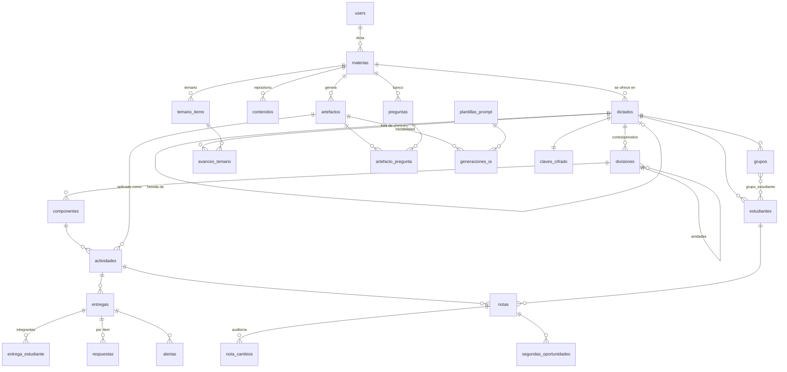

# Diseño detallado — modelo de datos y motor de IA

Plataforma educativa · basado en el documento de requerimientos v3 y en la revisión (`revision-requerimientos-v3.md`).
Stack: Laravel 12 o superior, PHP 8.4 o superior, MySQL 8 (o MariaDB 10.6 o superior).

Este diseño ya incorpora las correcciones propuestas en la revisión:

- B1: la materia guarda una plantilla de evaluación y el dictado la estructura real.
- B2: el documento es único por dictado.
- 11.5: un estudiante puede estar en varios grupos.
- A2: un par de claves por dictado, con la clave privada cifrada.

---

## 1. Diagrama entidad-relación



### Decisiones del modelo

| Decisión | Razón | Requerimiento |
|---|---|---|
| `estudiantes` cuelga del **dictado**, con un pivote a `grupos` | El documento es único por dictado. Un estudiante en dos grupos no se duplica | 9.1, 11.5, 3.1.12 |
| `divisiones` es autorreferenciada (`parent_id`) | Año → semestre → corte, o año → periodo, sin imponer jerarquía | 2.7 |
| La materia guarda la plantilla de evaluación en JSON y el dictado la copia a `divisiones` y `componentes` | Plantilla estable frente a estructura real del periodo | 2.6, B1 |
| `notas.valor` es `decimal(7,4)`, no `float` | Precisión completa interna; se redondea solo al mostrar | 3.2.3 |
| `notas.valor` admite `NULL` | Celda vacía ≠ cero | 3.1.6 |
| `nota_cambios` es de solo inserción (sin `updated_at`) | Bitácora inmutable | 3.5 |
| `segundas_oportunidades` es una tabla aparte | La nota original nunca se borra | 3.6 |
| `entrega_estudiante` como pivote | El grupo viaja con la entrega y la nota baja a todos | 6.8 |
| `artefactos.sigla` única con `uuid` embebido | Autodetección del examen y de la actividad equivocada | 6.1.3, 6.1.4 |
| `pregunta_usos` | Historial de uso de preguntas entre dictados | 5.4.13 |
| `claves_cifrado` por dictado, privada `encrypted` | Limita el radio de impacto de una filtración | A2 |

---

## 2. Migraciones (núcleo de fases 0 a 2)

Una migración por bloque lógico. Se usan nombres en español para el dominio, igual que en el documento.

### 2.1 Materia, temario y repositorio

```php
// database/migrations/2026_12_01_000001_create_materias_table.php
return new class extends Migration {
    public function up(): void
    {
        Schema::create('materias', function (Blueprint $t) {
            $t->id();
            $t->foreignId('user_id')->constrained()->cascadeOnDelete();
            $t->string('nombre');
            $t->string('codigo', 30)->nullable();
            $t->enum('nivel', ['universidad', 'colegio', 'otro'])->default('universidad');
            $t->boolean('perfil_codigo')->default(false);          // 1.4: el código es opcional
            $t->enum('modalidad_practica', ['integrada', 'anexo', 'ninguna'])->default('ninguna');
            $t->json('plantilla_evaluacion')->nullable();          // B1: cortes/componentes sugeridos
            $t->json('estilo')->nullable();                        // capa 2 (8.2): tono, glosario, etc.
            $t->timestamps();
            $t->softDeletes();
            $t->unique(['user_id', 'codigo']);
        });

        Schema::create('temario_items', function (Blueprint $t) {
            $t->id();
            $t->foreignId('materia_id')->constrained()->cascadeOnDelete();
            $t->foreignId('parent_id')->nullable()->constrained('temario_items')->cascadeOnDelete();
            $t->enum('tipo', ['unidad', 'tema', 'resultado']);
            $t->string('titulo');
            $t->text('descripcion')->nullable();
            $t->unsignedSmallInteger('orden')->default(0);
            $t->enum('origen', ['ia', 'manual'])->default('manual'); // 1.2: IA por defecto, manual siempre
            $t->timestamps();
        });

        Schema::create('contenidos', function (Blueprint $t) {
            $t->id();
            $t->foreignId('materia_id')->constrained()->cascadeOnDelete();
            $t->foreignId('temario_item_id')->nullable()->constrained()->nullOnDelete();
            $t->string('titulo');
            $t->string('tipo', 30);                 // plan_curricular, syllabus, presentacion, pdf, codigo...
            $t->string('ruta');                     // Storage::disk('local'), nunca público
            $t->string('mime', 100);
            $t->char('sha256', 64);
            $t->unsignedInteger('version')->default(1);
            $t->longText('texto_extraido')->nullable(); // para usarlo como contexto de IA
            $t->timestamps();
        });
    }
};
```

### 2.2 Dictado, divisiones, grupos y estudiantes

```php
// 2026_12_01_000002_create_dictados_table.php
Schema::create('dictados', function (Blueprint $t) {
    $t->id();
    $t->foreignId('materia_id')->constrained()->cascadeOnDelete();
    $t->foreignId('origen_dictado_id')->nullable()->constrained('dictados')->nullOnDelete(); // 2.8
    $t->string('periodo', 20);                         // "2026A", "2027-P1"
    $t->decimal('escala_min', 7, 4)->default(0);
    $t->decimal('escala_max', 7, 4)->default(5);
    $t->decimal('nota_aprobatoria', 7, 4)->default(3);
    $t->unsignedTinyInteger('decimales')->default(1);
    $t->enum('redondeo', ['cercano', 'arriba', 'abajo'])->default('cercano');
    $t->enum('estado', ['abierto', 'cerrado'])->default('abierto');
    $t->timestamps();
    $t->unique(['materia_id', 'periodo']);
});

Schema::create('divisiones', function (Blueprint $t) {            // cortes, periodos, bimestres...
    $t->id();
    $t->foreignId('dictado_id')->constrained()->cascadeOnDelete();
    $t->foreignId('parent_id')->nullable()->constrained('divisiones')->cascadeOnDelete();
    $t->string('nombre');                                     // lo pone el docente (2.7.3)
    $t->decimal('peso', 7, 4);                                // fracción 0..1 dentro del padre
    $t->date('fecha_inicio')->nullable();
    $t->date('fecha_fin')->nullable();
    $t->unsignedSmallInteger('orden')->default(0);
    $t->timestamps();
});

Schema::create('componentes', function (Blueprint $t) {           // trabajos y quices, parcial...
    $t->id();
    $t->foreignId('division_id')->constrained('divisiones')->cascadeOnDelete();
    $t->string('nombre');
    $t->decimal('peso', 7, 4);
    $t->unsignedSmallInteger('orden')->default(0);
    $t->timestamps();
});

Schema::create('grupos', function (Blueprint $t) {
    $t->id();
    $t->foreignId('dictado_id')->constrained()->cascadeOnDelete();
    $t->string('nombre');                                     // "Diurno", "Nocturno"
    $t->string('jornada', 20)->nullable();
    $t->timestamps();
    $t->unique(['dictado_id', 'nombre']);
});

Schema::create('estudiantes', function (Blueprint $t) {
    $t->id();
    $t->foreignId('dictado_id')->constrained()->cascadeOnDelete();
    $t->string('documento', 20);
    $t->string('apellidos');
    $t->string('nombres');
    $t->unsignedTinyInteger('numero_matriculas')->nullable();
    $t->unsignedTinyInteger('numero_convocatorias')->nullable();
    $t->text('observacion')->nullable();
    $t->string('email')->nullable();
    $t->string('telefono', 30)->nullable();
    $t->boolean('revisar_nombre')->default(false);           // 3.4.5: fila sin coma
    $t->timestamps();
    $t->unique(['dictado_id', 'documento']);                 // B2 / 9.1
});

Schema::create('grupo_estudiante', function (Blueprint $t) {      // 11.5: puede estar en dos grupos
    $t->foreignId('grupo_id')->constrained()->cascadeOnDelete();
    $t->foreignId('estudiante_id')->constrained()->cascadeOnDelete();
    $t->boolean('activo')->default(true);                    // 3.4.6: "ya no aparece" → se marca, no se borra
    $t->primary(['grupo_id', 'estudiante_id']);
});

Schema::create('avances_temario', function (Blueprint $t) {      // 7.1.4 lista de chequeo
    $t->id();
    $t->foreignId('dictado_id')->constrained()->cascadeOnDelete();
    $t->foreignId('grupo_id')->nullable()->constrained()->cascadeOnDelete(); // alcance por grupo
    $t->foreignId('temario_item_id')->constrained()->cascadeOnDelete();
    $t->date('cubierto_en');
    $t->unique(['grupo_id', 'temario_item_id']);
});
```

### 2.3 Artefactos, banco y actividades

```php
// 2026_12_01_000003_create_artefactos_table.php
Schema::create('artefactos', function (Blueprint $t) {
    $t->id();
    $t->foreignId('materia_id')->constrained()->cascadeOnDelete();
    $t->foreignId('origen_artefacto_id')->nullable()->constrained('artefactos')->nullOnDelete();
    $t->uuid('uuid')->unique();                             // embebido en el HTML (6.1.4)
    $t->string('sigla', 40)->unique();                      // "ED-2026A-P2"
    $t->string('tipo', 30);                                 // quiz, parcial, taller, manual, rubrica...
    $t->string('titulo');
    $t->json('configuracion');                              // panel 5.7 completo
    $t->json('especificacion_calificacion')->nullable();    // A1: reglas definidas una sola vez
    $t->text('solucionario')->nullable();                   // cast encrypted (A2)
    $t->unsignedInteger('version')->default(1);
    $t->timestamp('ensayado_en')->nullable();               // 5.6.4
    $t->string('ensayado_equipo')->nullable();
    $t->timestamps();
});

Schema::create('preguntas', function (Blueprint $t) {
    $t->id();
    $t->foreignId('materia_id')->constrained()->cascadeOnDelete();
    $t->foreignId('temario_item_id')->nullable()->constrained()->nullOnDelete(); // 5.4.14
    $t->string('tipo', 30);              // unica, multiple, vf, emparejar, ordenar, completar, abierta, reto
    $t->enum('dificultad', ['baja', 'media', 'alta'])->default('media');
    $t->json('enunciado');               // texto, opciones, casos visibles
    $t->text('clave');                   // cast encrypted: respuesta, casos reservados
    $t->text('justificacion')->nullable();               // 6.4: una línea de justificación
    $t->timestamps();
});

Schema::create('artefacto_pregunta', function (Blueprint $t) {
    $t->id();
    $t->foreignId('artefacto_id')->constrained()->cascadeOnDelete();
    $t->foreignId('pregunta_id')->constrained()->restrictOnDelete();
    $t->string('banco', 5)->default('A');                // A, B, 2A, 2B (5.4.2)
    $t->decimal('peso', 7, 4);
    $t->unsignedSmallInteger('orden');
    $t->timestamp('anulada_en')->nullable();             // 6.5.5
    $t->enum('regla_anulacion', ['dar_por_buena', 'retirar_y_reescalar'])->nullable();
    $t->string('motivo_anulacion')->nullable();
});

Schema::create('actividades', function (Blueprint $t) {
    $t->id();
    $t->foreignId('componente_id')->constrained()->cascadeOnDelete();
    $t->foreignId('artefacto_id')->nullable()->constrained()->nullOnDelete(); // trazabilidad
    $t->string('nombre');
    $t->date('fecha')->nullable();
    $t->decimal('valor_max', 7, 4);                     // en la escala del dictado
    $t->decimal('peso_escrita', 5, 4)->default(0.5);    // B3: el 50/50 pasa a ser un parámetro
    $t->boolean('es_grupal')->default(false);
    $t->unsignedTinyInteger('tamano_grupo')->nullable();     // 6.8 tope
    $t->decimal('tope_exceso', 7, 4)->nullable();
    $t->unsignedSmallInteger('orden')->default(0);
    $t->timestamps();
});

Schema::create('actividad_grupo', function (Blueprint $t) {      // a qué grupos se aplica
    $t->foreignId('actividad_id')->constrained('actividades')->cascadeOnDelete();
    $t->foreignId('grupo_id')->constrained()->cascadeOnDelete();
    $t->primary(['actividad_id', 'grupo_id']);
});

Schema::create('pregunta_usos', function (Blueprint $t) {        // 5.4.13
    $t->foreignId('pregunta_id')->constrained()->cascadeOnDelete();
    $t->foreignId('actividad_id')->constrained('actividades')->cascadeOnDelete();
    $t->foreignId('grupo_id')->constrained()->cascadeOnDelete();
    $t->primary(['pregunta_id', 'actividad_id', 'grupo_id']);
});
```

### 2.4 Entregas, notas y auditoría

```php
// 2026_12_01_000004_create_entregas_notas_tables.php
Schema::create('entregas', function (Blueprint $t) {
    $t->id();
    $t->foreignId('actividad_id')->constrained('actividades')->cascadeOnDelete();
    $t->foreignId('subida_por_id')->nullable()->constrained('estudiantes')->nullOnDelete();
    $t->string('sigla_detectada', 40)->nullable();
    $t->uuid('artefacto_uuid_detectado')->nullable();     // actividad equivocada (6.1.4)
    $t->string('version', 5)->nullable();                 // A / B
    $t->string('ruta');
    $t->char('sha256', 64);
    $t->boolean('cifrada')->default(true);                // alerta "sin cifrar"
    $t->json('sesion')->nullable();                       // salidas con duración, pegados, ejecuciones
    $t->unsignedInteger('duracion_seg')->nullable();
    $t->enum('cierre', ['manual', 'automatico'])->nullable();
    $t->timestamp('procesada_en')->nullable();
    $t->timestamps();
    $t->unique(['actividad_id', 'sha256']);               // la misma entrega no se carga dos veces
});

Schema::create('entrega_estudiante', function (Blueprint $t) {   // 6.8: integrantes por documento
    $t->foreignId('entrega_id')->constrained()->cascadeOnDelete();
    $t->foreignId('estudiante_id')->constrained()->cascadeOnDelete();
    $t->primary(['entrega_id', 'estudiante_id']);
});

Schema::create('respuestas', function (Blueprint $t) {           // detalle por ítem (6.4, 6.7)
    $t->id();
    $t->foreignId('entrega_id')->constrained()->cascadeOnDelete();
    $t->foreignId('artefacto_pregunta_id')->constrained('artefacto_pregunta')->cascadeOnDelete();
    $t->json('respuesta');
    $t->decimal('puntaje', 7, 4)->nullable();             // NULL = abierta sin calificar
    $t->decimal('puntaje_max', 7, 4);
    $t->json('desglose')->nullable();                     // par por par, caso por caso, consola
    $t->text('comentario')->nullable();
    $t->unique(['entrega_id', 'artefacto_pregunta_id']);
});

Schema::create('notas', function (Blueprint $t) {
    $t->id();
    $t->foreignId('actividad_id')->constrained('actividades')->cascadeOnDelete();
    $t->foreignId('estudiante_id')->constrained()->cascadeOnDelete();
    $t->decimal('valor', 7, 4)->nullable();               // NULL = vacía (3.1.6)
    $t->enum('origen', ['digitada', 'archivo', 'calificador', 'grupal', 'migracion']);
    $t->foreignId('entrega_id')->nullable()->constrained()->nullOnDelete(); // trazabilidad 6.6
    $t->boolean('ajuste_individual')->default(false);     // 6.8.7
    $t->text('comentario')->nullable();
    $t->timestamps();
    $t->unique(['actividad_id', 'estudiante_id']);
});

Schema::create('nota_cambios', function (Blueprint $t) {         // 3.5: solo inserción
    $t->id();
    $t->foreignId('nota_id')->constrained()->cascadeOnDelete();
    $t->foreignId('user_id')->nullable()->constrained()->nullOnDelete();
    $t->decimal('valor_anterior', 7, 4)->nullable();
    $t->decimal('valor_nuevo', 7, 4)->nullable();
    $t->string('origen', 30);       // digitada, calificador, ajuste_grupal, anulacion_item, ceros_explicitos
    $t->string('motivo')->nullable();
    $t->uuid('operacion_id');       // agrupa una operación para "deshacer por operación" (3.1.9)
    $t->timestamp('created_at')->useCurrent();
    $t->index('operacion_id');
});

Schema::create('segundas_oportunidades', function (Blueprint $t) { // 3.6
    $t->id();
    $t->foreignId('estudiante_id')->constrained()->cascadeOnDelete();
    $t->morphs('ambito');           // Actividad, Division (corte) o Dictado
    $t->enum('tipo', ['supletorio', 'habilitacion', 'recuperacion']);
    $t->decimal('valor', 7, 4);
    $t->enum('regla', ['reemplaza', 'promedia', 'tope']);
    $t->decimal('tope', 7, 4)->nullable();
    $t->date('fecha');
    $t->timestamps();
});

Schema::create('alertas', function (Blueprint $t) {              // 6.3
    $t->id();
    $t->foreignId('actividad_id')->constrained('actividades')->cascadeOnDelete();
    $t->foreignId('entrega_id')->nullable()->constrained()->cascadeOnDelete();
    $t->foreignId('estudiante_id')->nullable()->constrained()->cascadeOnDelete();
    $t->string('tipo', 40);         // manipulado, grupo_no_cuadra, examen_no_reconocido, similitud...
    $t->json('datos')->nullable();  // p. ej. lista de salidas con duración, par similar y puntaje
    $t->timestamp('revisada_en')->nullable();
    $t->timestamps();
});
```

**Ajuste en la implementación:** `nota_cambios` no tiene llaves foráneas (guarda `nota_id`, `actividad_id` y `estudiante_id` como columnas simples). Un `ON DELETE CASCADE` chocaría con los triggers de solo lectura, y la bitácora debe sobrevivir al borrado de la actividad (9.1). Además, el modelo de configuración se llama `ConfigMotorIa`: PHP no distingue mayúsculas en nombres de clase y `MotorIa` chocaba con la interfaz `MotorIA`.

**Para que la bitácora sea realmente inmutable**, conviene protegerla en dos capas:

```php
// En el modelo NotaCambio
public const UPDATED_AT = null;
protected static function booted(): void
{
    static::updating(fn () => throw new LogicException('La bitácora de notas es de solo lectura.'));
    static::deleting(fn () => throw new LogicException('La bitácora de notas es de solo lectura.'));
}
```

Además, en MySQL, triggers `BEFORE UPDATE` y `BEFORE DELETE` sobre `nota_cambios` que hagan `SIGNAL SQLSTATE '45000'`. La protección de Eloquent se salta con `DB::table()`; el trigger no.

### 2.5 Prompts, motor de IA y claves

```php
// 2026_12_01_000005_create_ia_tables.php
Schema::create('plantillas_prompt', function (Blueprint $t) {
    $t->id();
    $t->foreignId('user_id')->constrained()->cascadeOnDelete();
    $t->foreignId('materia_id')->nullable()->constrained()->cascadeOnDelete(); // NULL = capa 1 o biblioteca
    $t->enum('capa', ['contexto', 'materia', 'tarea']);
    $t->string('clave', 50);         // "quiz", "rubrica", "unidad_didactica"... (catálogo 7.4)
    $t->string('nombre');
    $t->longText('cuerpo');          // con {{variables}}
    $t->unsignedInteger('version');
    $t->boolean('activa')->default(true);
    $t->timestamps();
    $t->unique(['user_id', 'materia_id', 'capa', 'clave', 'version']);
});

Schema::create('motores_ia', function (Blueprint $t) {           // 1.5
    $t->id();
    $t->foreignId('user_id')->constrained()->cascadeOnDelete();
    $t->string('nombre');                   // "Ollama del laboratorio"
    $t->string('driver', 30);               // ollama, openai_compatible, anthropic...
    $t->string('base_url')->nullable();     // http://192.168.1.20:11434
    $t->string('modelo');                   // "qwen3:14b", "claude-sonnet-5-5"...
    $t->boolean('es_local');
    $t->text('api_key')->nullable();        // cast encrypted
    $t->boolean('predeterminado')->default(false);
    $t->timestamps();
});

Schema::create('generaciones_ia', function (Blueprint $t) {      // 7.7, 8.4.6
    $t->id();
    $t->foreignId('motor_ia_id')->constrained('motores_ia')->restrictOnDelete();
    $t->nullableMorphs('resultado');        // Artefacto, TemarioItem, comentario...
    $t->json('plantillas');                 // ids y versiones de las 3 capas usadas
    $t->json('contenidos_contexto');        // ids y sha256 del material usado
    $t->longText('prompt_final');
    $t->longText('respuesta');
    $t->boolean('contiene_datos_estudiantes')->default(false);
    $t->unsignedInteger('tokens_entrada')->nullable();
    $t->unsignedInteger('tokens_salida')->nullable();
    $t->unsignedInteger('duracion_ms')->nullable();
    $t->timestamps();
});

Schema::create('claves_cifrado', function (Blueprint $t) {       // A2: un par por dictado
    $t->id();
    $t->foreignId('dictado_id')->unique()->constrained()->cascadeOnDelete();
    $t->text('publica_jwk');                // se embebe en el HTML del estudiante (RSA-OAEP 2048)
    $t->text('privada_jwk');                // cast encrypted
    $t->timestamp('rotada_en')->nullable();
    $t->timestamps();
});
```

---

## 3. Servicio de cálculo de notas (reglas de 3.2)

Todo el cálculo va en una sola clase pura, sin consultas a la base de datos, para poder probarla con PHPUnit o Pest sin base de datos. El simulador de cierre (3.7) reutiliza esta misma clase.

```php
final class CalculadoraNotas
{
    /** @param array<int, ?string> $notas valores decimales en texto; null = vacía */
    public function promedioComponente(array $notas): ?string
    {
        $registradas = array_filter($notas, fn ($v) => $v !== null);   // 3.1.6: ignora vacías
        if ($registradas === []) {
            return null;
        }
        $suma = array_reduce($registradas, fn ($c, $v) => bcadd($c, $v, 6), '0');
        return bcdiv($suma, (string) count($registradas), 6);
    }

    /** @param array<int, array{peso:string, promedio:?string, tiene_actividades:bool}> $componentes */
    public function definitivaDivision(array $componentes): ResultadoDivision
    {
        $definitiva = '0';
        foreach ($componentes as $c) {
            if ($c['tiene_actividades'] && $c['promedio'] === null) {
                return ResultadoDivision::incompleto();                  // 3.1.14
            }
            if ($c['promedio'] !== null) {
                $definitiva = bcadd($definitiva, bcmul($c['promedio'], $c['peso'], 6), 6);
            }
        }
        return ResultadoDivision::con($definitiva);
    }

    public function notaNecesaria(string $acumulado, string $pesoPendiente, string $aprobatoria): ?string
    {
        // 3.7.1: aprobatoria = acumulado + x * pesoPendiente  →  x = (aprobatoria - acumulado) / pesoPendiente
        if (bccomp($pesoPendiente, '0', 6) === 0) {
            return null;
        }
        return bcdiv(bcsub($aprobatoria, $acumulado, 6), $pesoPendiente, 6);
    }

    public function mostrar(string $valor, Dictado $d): string   // 3.2.3: redondear solo al mostrar
    {
        // aplica $d->decimales y $d->redondeo
    }
}
```

> **Implementado:** se usa `brick/math`, porque el servidor de desarrollo no trae `bcmath`. Se usa en vez de `float`: con `float`, `0.1 + 0.2` no da `0.3`, y con notas al margen (2.95 contra 3.0) ese error decide si alguien aprueba.

**Pruebas que deben existir desde el día 1:**

- Las celdas vacías no promedian.
- Convertir vacías en ceros cambia el resultado y queda en la bitácora.
- Un componente sin notas pero con actividades deja el corte «Incompleto».
- 30/30/40 con notas conocidas da la definitiva esperada.
- Nota necesaria > `escala_max` → «no alcanza».
- Redondeo «al más cercano» de 2.95 con un decimal → 3.0, mientras el estado interno sigue en 2.95, así que el caso «aprueba solo por redondeo» (3.7.2) se detecta.

---

## 4. Interfaz común del motor de IA (sección 1.5)

### 4.1 Contrato

```php
namespace App\IA;

interface MotorIA
{
    public function generar(SolicitudIA $solicitud): RespuestaIA;
    public function disponible(): bool;      // ping corto, para avisar antes de generar
    public function esLocal(): bool;
}

final readonly class SolicitudIA
{
    public function __construct(
        public string $sistema,                  // capas 1 + 2 ya armadas
        public string $usuario,                  // capa 3 + material de contexto
        public bool $contieneDatosEstudiantes = false,
        public ?array $esquemaJson = null,       // para salidas estructuradas (banco, temario)
        public float $temperatura = 0.4,
        public int $maxTokens = 4096,
    ) {}
}

final readonly class RespuestaIA
{
    public function __construct(
        public string $texto,
        public ?int $tokensEntrada,
        public ?int $tokensSalida,
        public int $duracionMs,
    ) {}
}
```

### 4.2 Drivers

| Driver | Cubre | Endpoint |
|---|---|---|
| `OllamaDriver` | Ollama | `POST {base_url}/api/chat` con `stream:false` y `format` (JSON schema) para salidas estructuradas |
| `OpenAICompatibleDriver` | LM Studio, llama.cpp server, vLLM y cualquier servidor compatible | `POST {base_url}/v1/chat/completions` |
| `AnthropicDriver` (u otro en la nube) | Servicio externo | API del proveedor, con la `api_key` cifrada |

Cada driver usa el cliente HTTP de Laravel con `timeout` explícito y sin reintentos hacia otro motor. Antes de escribir los drivers a mano, vale la pena evaluar paquetes que ya abstraen varios proveedores (Prism, por ejemplo) y envolverlos detrás de `MotorIA`. Así, si el paquete cambia, el resto de la aplicación no se entera.

### 4.3 Reglas 1.5.3 y 1.5.4 en código: sin caída silenciosa a la nube

```php
final class GestorIA
{
    public function __construct(private ResolutorMotor $resolutor) {}

    public function generar(SolicitudIA $s, ?ConfigMotorIa $config = null): RespuestaIA
    {
        $config ??= ConfigMotorIa::predeterminadoDe(auth()->user());
        $motor = $this->resolutor->para($config);

        // 1.5.3: datos de estudiantes → solo motor local, salvo autorización explícita
        if ($s->contieneDatosEstudiantes && ! $motor->esLocal()
            && ! config('ia.permitir_nube_con_datos_estudiantes')) {
            throw new MotorNoPermitido(
                'Esta tarea procesa trabajo de estudiantes y el motor configurado es en la nube. '
                .'Configure un motor local o autorice el uso de la nube en Ajustes.'
            );
        }

        // 1.5.4: si no está disponible, se avisa; NUNCA se intenta con otro motor
        if (! $motor->disponible()) {
            throw new MotorNoDisponible("El motor «{$config->nombre}» no responde en {$config->base_url}.");
        }

        $r = $motor->generar($s);
        GeneracionIa::registrar($config, $s, $r);    // trazabilidad 7.7 / 8.4.6
        return $r;
    }
}
```

**Pruebas clave:**

- Con el motor local caído, `generar()` lanza `MotorNoDisponible` y **no se hace ninguna petición HTTP a otro host** (se verifica con `Http::fake()` y `Http::assertSentCount`).
- Con `contieneDatosEstudiantes = true` y un motor en la nube, se lanza `MotorNoPermitido`.
- Cambiar de motor no cambia las plantillas: el mismo `SolicitudIA` funciona con los tres drivers, probado con respuestas falsas.

### 4.4 Armado del prompt (módulo 5)

```
ConstructorPrompt
  ├─ capa1(user)         ← institución, escala del dictado, pesos de las divisiones  (8.1)
  ├─ capa2(materia)      ← materias.estilo + alcance por grupo (avances_temario)     (8.2)
  ├─ capa3(clave, datos) ← plantillas_prompt[capa=tarea, clave] + parámetros 5.7     (8.3)
  └─ contexto(contenidos seleccionados) ← texto_extraido, recortado a la ventana del modelo
       → SolicitudIA  →  vista previa editable (8.4.3)  →  GestorIA::generar
```

- Los `{{campos}}` se llenan con lo que ya está en la base de datos (8.4.2).
- Un campo obligatorio vacío detiene el armado antes de llamar al motor (8.4.1).
- Con modelos locales la ventana de contexto es corta. El constructor debe priorizar el material del tema pedido y avisar cuando recorta algo.

---

## 5. Lo que este diseño deja listo y lo que falta

**Cubre:** el esqueleto completo de las fases 0 a 2 (fusionadas según B8), la auditoría, las segundas oportunidades, las entregas grupales, la trazabilidad nota → entrega → artefacto, y la interfaz de IA con las reglas de 1.5.

**Pendiente de decidir antes de programar el calificador:**

1. Dónde se ejecuta el código del estudiante al calificar (revisión A1).
2. El formato JSON de `especificacion_calificacion`, que depende de A1.
3. El formato exacto del archivo de entrega. Debe ser compatible con el AES-GCM + RSA-OAEP actual para la migración del corte en curso (sección 10).
